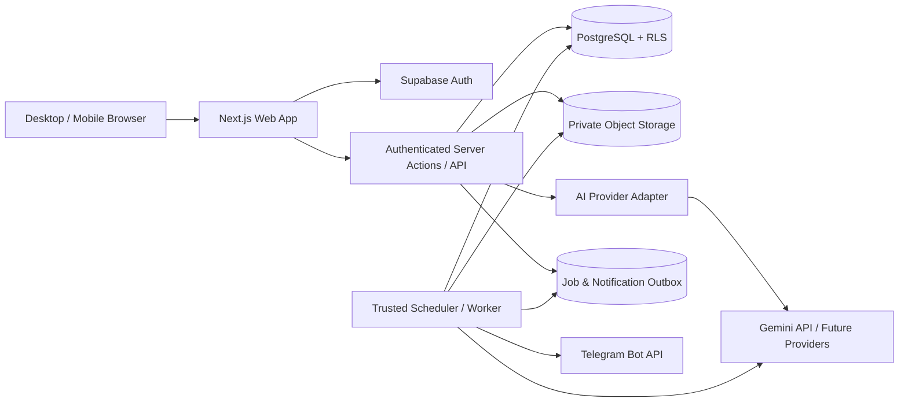
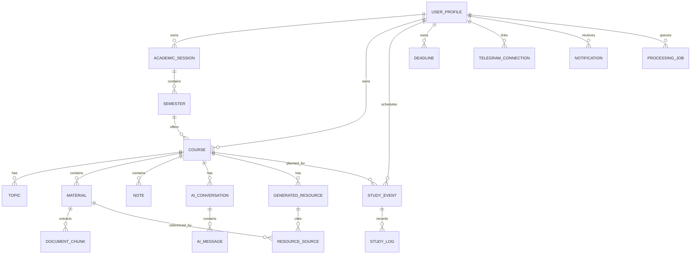
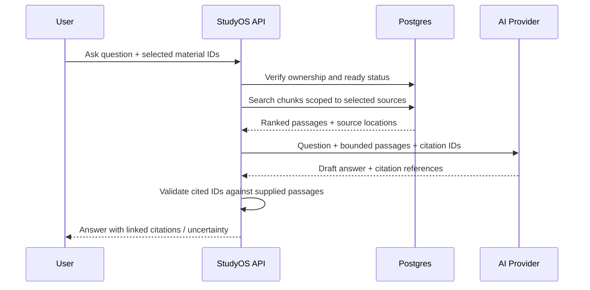
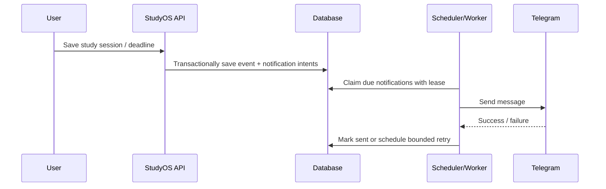

# StudyOS — Product Plan & Technical Architecture

**Status:** Architecture proposal — implementation not started  
**Version:** 1.0 · 8 November 2026  
**Owner:** Personal academic workspace  
**Primary timezone:** `Africa/Lagos` (configurable)  
**Guiding principle:** Source-first studying, reliable scheduling, optional AI.

> This document is the source of truth for Codex during initial development. Codex should review assumptions, confirm external-service constraints, and request approval before implementing Phase 1.

## 1. Executive summary

StudyOS is a responsive, private academic productivity web application for organizing university and self-directed learning. It supports unlimited user-created academic sessions, semesters, courses, topics, materials, notes, AI-generated learning resources, study plans, progress records, and Telegram reminders. The first dataset is the user's UNIOSUN 400-level Harmattan semester; the data model must not hardcode any academic year, semester, or course.

**Success criteria:** A user can sign in on a laptop or phone, create a semester and course, upload and read a PDF, write a note, schedule study time, receive a Telegram reminder while the browser is closed, and optionally ask an AI question grounded in selected documents. AI outages must not block core study functions.

### 1.1 Product principles

1. **Flexible:** Courses can belong to any academic session/semester or to a standalone learning collection.
2. **Source-first:** Original documents remain accessible independently of extraction and AI processing.
3. **Private:** User-scoped access, private storage, server-side credentials, and least privilege.
4. **Reliable:** Autosave, idempotent reminders, durable scheduling, recoverable processing jobs.
5. **Affordable:** Start with one user and managed infrastructure; set budgets and usage limits.
6. **Mobile-first usability:** Full functionality on phone, not merely a squeezed desktop layout.
7. **Incremental:** Each phase ships a usable, tested slice with clear acceptance criteria.

## 2. Scope and priorities

### 2.1 MVP (first complete usable release)

- Sign-in, protected routes, user profile, timezone/preferences.
- Academic sessions, flexible semesters, course CRUD, course topics and completion.
- Course-specific library: PDF, DOCX, PPTX, TXT, MD and image uploads; secure download; PDF inline reader; metadata/search.
- Rich-text personal notes with safe rendering and autosave.
- AI Studio v1: source extraction, selected-source summarization, study notes, flashcards, practice questions, and grounded Q&A with references where available.
- Calendar with one-off and recurring study blocks, assignment/exam deadlines, timer and study logs.
- Telegram account linking and configurable scheduled reminders.
- Responsive dashboard with real progress and activity metrics.
- Basic tests, production deployment, backup/export procedure and monitoring.

### 2.2 Later enhancements (not launch blockers)

- OCR for scanned PDFs and handwriting; image interpretation; website/YouTube sources.
- Semantic vector retrieval at scale, cross-course knowledge search.
- Spaced repetition, flashcard scheduling, advanced adaptive quizzes.
- Offline-first PWA, document annotations and collaborative sharing.
- AI-generated audio overviews, mind maps, presentations and multi-agent workflows.
- Full multi-user onboarding, team spaces and institution-wide deployment.

### 2.3 Explicit non-goals for MVP

No social feed, public document sharing, grade prediction, plagiarism guarantees, automatic official exam date discovery, or AI-dependent access to files.

## 3. Initial seed data

Seed **only** the following 10 courses in a configurable Harmattan semester. Academic year/session should be chosen during onboarding rather than guessed. Do not seed fictional topics, dates, grades or progress.

| Code | Course | Units |
|---|---|---:|
| CSC401 | Software Engineering | 3 |
| CSC403 | Artificial Intelligence | 3 |
| CYB401 | System Vulnerability Assessment & Testing | 3 |
| CYB403 | Cloud Computing Security | 2 |
| CYB405 | Information Disaster Recovery | 2 |
| CYB407 | VoIP & Multimedia Security | 2 |
| CYB409 | Enterprise Security & Information Assurance | 2 |
| CYB411 | Special Topics in Computing | 2 |
| CYB415 | Threats, Exploits & CounterMeasures | 2 |
| CYB497 | Research Methodology | 1 |
| **Total** | **10 courses** | **22** |

Courses must be editable, archivable, and transferable/copiable between semesters. Do not delete historical progress implicitly when moving a course; prefer creating a new course offering/instance when retaking it.

## 4. User journeys

1. **Onboard:** Sign in → set timezone → create academic session and semester → import optional seed courses.
2. **Organize:** Create a course → add topics → upload sources → categorize and search.
3. **Read and take notes:** Open source in reader → write/edit note → autosave → resume on phone.
4. **Generate learning resources:** Select sources → choose output type and instructions → generate → inspect citations → edit/save to course.
5. **Ask about sources:** Select course documents → ask question → read grounded response with clickable source references; see clear uncertainty if not supported.
6. **Plan:** Create recurring study block → select course/topic → set reminder lead time → receive Telegram message.
7. **Track:** Start/pause/finish timer → save actual duration → complete topics → review dashboard.
8. **Recover:** Retry failed extraction, re-open original file, export notes, reschedule missed sessions.

## 5. Recommended technology stack

| Layer | Proposed choice | Rationale / caution |
|---|---|---|
| Web | Next.js App Router, React, strict TypeScript | One codebase for server-rendered and interactive pages. |
| UI | Tailwind CSS, shadcn/ui, accessible primitives | Consistent responsive UI; own the generated components. |
| Forms/validation | React Hook Form + Zod | Shared runtime validation and typed forms. |
| Auth | Supabase Auth | Managed sessions; verify server/client auth boundaries. |
| Database | Supabase Postgres | SQL, transactions, RLS, migrations. |
| Files | Supabase private Storage buckets | Signed short-lived access and ownership policies. |
| Editor | Tiptap | Rich text; sanitize output and version edits. |
| PDF | PDF.js / react-pdf | Inline viewing, page navigation; check licensing/compatibility. |
| Calendar | FullCalendar or lighter custom views | Evaluate bundle size and mobile behavior before committing. |
| AI | Gemini API behind provider adapter | First provider to evaluate, not a hard dependency. |
| Retrieval v1 | Postgres full-text search + scoped chunks | Lower cost/complexity than vectors for initial scale. |
| Retrieval v2 | pgvector embeddings if needed | Add only after measured relevance limitations. |
| Background jobs | Durable DB job/outbox tables + scheduled worker | Hosting scheduler must wake a server-side worker; verify plan limits. |
| Hosting | Vercel + Supabase, or equivalent | Confirm cron frequency, execution timeout and costs before selection. |
| Testing | Vitest, React Testing Library, Playwright | Logic, component and cross-device flows. |
| Observability | Structured logs + error tracking | Redact tokens, user documents and prompts. |

**Critical deployment caveat:** Vercel cron frequency and limits vary by plan. For reminders requiring minute-level accuracy, verify current capabilities or use a suitable always-on worker / managed scheduler. Never rely on browser timers or a serverless function that is not invoked.

## 6. High-level system architecture



### 6.1 Trust boundaries

- Browser is untrusted. All writes and reads require server-side authorization or scoped RLS policies.
- Storage is private. The client receives only time-limited signed URLs for authorized files.
- AI keys, Telegram bot tokens, service-role keys and scheduler secrets never enter client bundles.
- Worker has privileged access but explicitly checks user/resource ownership before processing jobs.
- Treat uploaded documents as untrusted content, including instructions embedded inside them.

### 6.2 Suggested repository layout

```text
studyos/
├── AGENTS.md
├── README.md
├── .env.example
├── docs/
│   ├── PRD.md
│   ├── ARCHITECTURE.md
│   ├── DATABASE.md
│   ├── ROADMAP.md
│   ├── SECURITY.md
│   ├── DECISIONS.md
│   └── PROGRESS.md
├── supabase/
│   ├── migrations/
│   └── seed.sql
├── src/
│   ├── app/
│   │   ├── (auth)/login/
│   │   ├── (app)/dashboard/
│   │   ├── (app)/sessions/
│   │   ├── (app)/courses/[courseId]/
│   │   ├── (app)/library/
│   │   ├── (app)/planner/
│   │   ├── (app)/ai-studio/
│   │   ├── (app)/analytics/
│   │   ├── (app)/settings/
│   │   └── api/internal/jobs/
│   ├── components/{layout,ui,courses,library,notes,planner,ai}/
│   ├── features/{academics,materials,notes,ai,planner,telegram,analytics}/
│   ├── lib/{auth,db,storage,validation,logging}/
│   ├── server/{services,repositories,jobs}/
│   └── types/
├── tests/{unit,integration,e2e}/
└── package.json
```

Organize feature modules around business capabilities; avoid duplicating business logic between API routes and components.

## 7. Information architecture and routes

| Route | Purpose |
|---|---|
| `/login` | Sign-in |
| `/dashboard` | Today, stats, next sessions, recent files |
| `/sessions` | Academic sessions and semesters |
| `/sessions/[sessionId]/semesters/[semesterId]` | Semester courses and overview |
| `/courses/new` | Create course or standalone learning course |
| `/courses/[courseId]` | Course overview |
| `/courses/[courseId]/topics` | Topic hierarchy/progress |
| `/courses/[courseId]/library` | Upload, filter and manage sources |
| `/courses/[courseId]/materials/[materialId]` | Reader and source metadata |
| `/courses/[courseId]/notes` | Personal and generated notes |
| `/courses/[courseId]/studio` | AI resource generation |
| `/courses/[courseId]/chat` | Grounded source chat |
| `/courses/[courseId]/planner` | Course-specific schedule |
| `/library` | Cross-course material browser |
| `/planner` | Daily/weekly/monthly calendar |
| `/analytics` | Study time, consistency, topic completion |
| `/settings` | Profile, timezone, data export |
| `/settings/integrations/telegram` | Link/test/unlink bot notifications |

Use URL-based tabs where useful, with preserved back-navigation and mobile-friendly navigation.

## 8. UI/UX specification

**Visual direction:** start with a simple light UI. Use light surfaces, readable typography, subtle accents and minimal decoration. Defer dark mode and a theme toggle.

**Desktop:** collapsible left sidebar, top bar, course cards, split document/notes/AI workspace. **Mobile:** bottom navigation or drawer, stacked cards, segmented tabs for Source / Notes / AI, full-screen reader when needed. Support ~320px viewport widths, touch targets ≥44px, keyboard navigation, focus indicators, loading/empty/error states and reduced-motion preferences.

**Primary dashboard widgets:** courses, study time this week, upcoming schedule, deadlines, topic progress, recently opened files, quick add. Do not display fabricated data; use genuine empty states.

**Study workspace:** desktop 2–3 panes where screen width permits; on mobile, a single active pane with persistent save indicators and easy source switching.

**Design tokens:** define the light palette, spacing, typography, radii, elevation and semantic status colors in one theme layer. Meet WCAG AA contrast targets where feasible.

## 9. Data model

### 9.1 Conceptual ER diagram



### 9.2 Core tables (initial proposal)

Every user-owned table has `user_id UUID NOT NULL` unless ownership is provably inherited and policies safely enforce it. Common fields: `id UUID PRIMARY KEY`, `created_at TIMESTAMPTZ`, `updated_at TIMESTAMPTZ`.

| Table | Key fields and constraints |
|---|---|
| `profiles` | `id` references auth user, `timezone`, `display_name`, preferences |
| `academic_sessions` | `user_id`, `label`, optional start/end dates, `archived_at`; unique user+label |
| `semesters` | `user_id`, `academic_session_id`, `name`, `sort_order`, optional dates; unique session+name |
| `courses` | `user_id`, nullable `semester_id` for standalone courses, `code`, `title`, `units`, `description`, `status`, `archived_at`; unique per semester+code where appropriate |
| `topics` | `user_id`, `course_id`, nullable `parent_topic_id`, `title`, `sort_order`, `completed_at` |
| `materials` | `user_id`, `course_id`, nullable `topic_id`, `name`, `mime_type`, `byte_size`, `storage_key`, `sha256`, `processing_status`, `page_count`, `deleted_at` |
| `document_chunks` | `user_id`, `material_id`, `chunk_index`, `text`, optional `page_start/page_end`, `text_search_vector`; unique material+index |
| `notes` | `user_id`, `course_id`, nullable `topic_id`, `title`, sanitized rich-text JSON, `revision`, `kind` (`personal`/`generated`), `deleted_at` |
| `ai_conversations` | `user_id`, `course_id`, `title`, optional selected source IDs as a separate join table |
| `ai_messages` | `user_id`, `conversation_id`, `role`, `content`, structured citation metadata, `model`, `created_at` |
| `generated_resources` | `user_id`, `course_id`, `kind`, `title`, structured content, `model`, `prompt_version`, `status` |
| `resource_sources` | `user_id`, `resource_id`, `material_id`, optional `chunk_id`/page range |
| `study_events` | `user_id`, nullable `course_id`/`topic_id`, `title`, `start_at`, `end_at`, `timezone`, `recurrence_rule`, `recurrence_until`, `status` |
| `study_logs` | `user_id`, `study_event_id` nullable, `course_id`, `started_at`, `ended_at`, `active_seconds`, `source`, `status` |
| `deadlines` | `user_id`, nullable `course_id`, `kind`, `title`, `due_at`, `status` |
| `telegram_connections` | `user_id`, `chat_id` (server-only), `verified_at`, `revoked_at`; do not store bot token per user |
| `notification_preferences` | `user_id`, enabled types, lead times, quiet hours, daily summary time |
| `notifications` | `user_id`, `kind`, `entity_type`, `entity_id`, `scheduled_for`, `status`, `attempts`, `next_attempt_at`, `idempotency_key` unique, `sent_at`, `last_error_code` |
| `processing_jobs` | `user_id`, `kind`, `resource_id`, `status`, `attempts`, `run_after`, `locked_until`, `error_code` |
| `ai_usage` | `user_id`, `provider`, `model`, token/cost estimates, operation, timestamp |

**Important normalization decisions:** Add `conversation_sources` for selected chat materials; store quiz/flashcard content as validated structured JSON initially, splitting into dedicated question/answer tables only when scheduling, querying, or analytics require it. Use explicit foreign keys and composite ownership checks to prevent attaching one user's material to another user's course.

### 9.3 Integrity and indexes

- Index `user_id` plus common filter/sort columns (`course_id`, `created_at`, `start_at`, `due_at`).
- Add GIN full-text indexes for searchable extracted chunks; use a consistent text-search configuration.
- Unique constraints on notification idempotency keys, document chunk order, and semester-specific course codes where appropriate.
- Check constraints: `units >= 0`, `end_at > start_at`, `active_seconds >= 0`, valid enum/status values.
- Soft-delete materials/notes first; asynchronously remove storage objects only after references are handled.
- Prevent cross-user foreign-key relationships using composite keys or server-side checks plus tested RLS.
- Use database migrations; never manually edit production schema without a migration.

### 9.4 RLS policy pattern

Enable RLS for every user-owned table. Baseline policy: authenticated `auth.uid() = user_id` for permitted SELECT/INSERT/UPDATE/DELETE, plus checks that referenced parent rows belong to the same user. Restrict sensitive tables (Telegram connections, job queues, provider usage) to appropriate server paths where possible. The service-role key is server-only and bypasses RLS; its use must be narrowly audited.

## 10. Files and document-processing pipeline

### 10.1 Upload flow

1. Authenticated user chooses a course and file.
2. Server validates course ownership, extension, actual MIME/content signature, max size and quota.
3. Create `materials` row with pending status and random object key such as `user-id/course-id/material-id/original`.
4. Upload to private storage with authorized short-lived upload token or authenticated storage policy.
5. Verify successful object write, persist metadata, enqueue extraction job.
6. Show file immediately in library even if extraction is pending.
7. Worker fetches file, parses safely, stores chunks and source page references, marks `ready` or `failed`.

**Suggested initial limits (configurable):** PDF/DOCX/PPTX/TXT/MD/JPEG/PNG; 25 MB/file; 250 MB total user storage. Confirm actual provider limits and costs. Scan/validate file types, enforce parsing timeouts and memory limits, never execute uploaded content or embedded macros.

### 10.2 Extraction

- PDF: extract text and page mapping; show `needs_ocr` for image-only pages.
- DOCX: extract paragraphs/tables and approximate section labels.
- PPTX: extract slide text with slide numbers.
- TXT/MD: UTF-8 normalized text.
- Images: store/view normally; OCR/vision deferred unless explicitly enabled.
- Chunk by section/page boundaries where possible, with overlap; retain `material_id`, page/slide range and chunk ordinal.
- Do not invent page numbers if extraction cannot preserve them.
- Document processing failures must not delete or hide originals.

### 10.3 Storage and retrieval

Use private buckets, opaque object keys, authorized signed URLs with short expiry, and storage deletion workflows. Search metadata first, then Postgres full-text chunks. Retrieval must filter by user and selected course/source IDs **before** ranking or passing text to the AI provider.

## 11. AI architecture

### 11.1 Provider abstraction

Define interfaces such as `generateText`, `generateStructured`, and `estimateUsage`, with a Gemini implementation first. Keep provider configuration server-side. Record model/version, latency, failures, and usage; set per-user daily request and token limits, max output length, and explicit timeout/retry behavior. AI should be disabled gracefully when no key is configured.

### 11.2 Grounded Q&A (RAG v1)



- Treat retrieved content as evidence, **not instructions**; explicitly resist prompt injection inside documents.
- Return only references to actual selected documents and verified page/slide ranges.
- Distinguish “according to your sources” from general model knowledge; default to source-only for grounded chat, with optional clearly labeled general explanation.
- When no relevant text is found, say so; never fabricate a citation.
- Persist conversation only when the feature is enabled and the user is authenticated.

### 11.3 Generation formats

| Type | Required structure |
|---|---|
| Study notes | Title, sections, definitions, explanations, examples, references |
| Summary | Short/medium/detailed length, key takeaways, references |
| Flashcards | Prompt, answer, optional explanation and source link |
| MCQ quiz | Question, 4 options, correct answer, explanation, source link |
| Theory questions | Question, model answer, key points, source link |
| Study guide | Objectives, topic outline, review plan, references |

Validate structured output with Zod before saving. Generated content is marked `AI-generated`, editable, and never overwrites original notes. Preserve the source IDs and generation parameters. Do not present generated questions as authentic university past questions.

### 11.4 Cost and privacy controls

Require explicit opt-in to send selected document excerpts to the configured AI provider. Display a brief privacy disclosure and relevant provider terms; avoid sending unrelated private files. Apply quotas, caching where appropriate, token budgets and clear error messages. No client-side API keys. Store only necessary request metadata in logs, not full source text by default.

## 12. Scheduling, timer and Telegram architecture

### 12.1 Time model

Store instants in UTC (`TIMESTAMPTZ`) and the user's IANA timezone separately. Store recurrence definitions with timezone to preserve intended local wall-clock time; expand occurrences within a rolling scheduling horizon (e.g. 30 days). Account for edits, cancellations, DST in other zones, and missed jobs.

### 12.2 Telegram linking

1. User opens Telegram integration page and requests a one-time link code/token.
2. Server generates a short-lived, single-use random token bound to authenticated user.
3. User opens the bot's deep link and sends `/start <token>`.
4. Secure bot webhook validates Telegram secret header (or equivalent authenticated transport), token expiry and one-time use.
5. Server binds verified `chat_id` to the user, then sends a test message.
6. User can unlink or disable notifications at any time.

Do not trust a chat ID typed into a browser as proof of ownership. Keep bot token in server secret storage.

### 12.3 Durable reminder workflow



- Use an outbox/notification table with deterministic `idempotency_key` (user + event occurrence + reminder type + offset + revision).
- Claim jobs atomically using row locking/leases (e.g. `FOR UPDATE SKIP LOCKED`), so concurrent workers do not send the same pending job.
- On event edit/cancel, invalidate unsent notification intents and create new ones.
- Retry transient failures with bounded exponential backoff; respect Telegram rate limits and `retry_after`.
- Record delivery outcome and expose a troubleshooting status in settings.
- **Delivery semantics:** exact-once external messaging cannot be guaranteed across network failures; aim for at-least-once processing with deduplication, acknowledging rare duplicate risk after ambiguous Telegram responses.
- Support quiet hours and configurable lead times; daily summary should be computed from the user's local day.
- Scheduler must run independently of the browser. Test real production scheduling frequency before promising exact timing.

### 12.4 Study timer accuracy

Maintain timer state with start/pause/resume timestamps and accumulated active seconds. Use a monotonic clock for on-screen elapsed time; reconcile with persisted server timestamps on reload. Do not count paused time, double-submit completion, or blindly count time while an inactive browser is suspended. Allow user correction of actual duration with audit-friendly updates.

## 13. Progress and analytics definitions

- **Topic completion:** completed topics / total active topics; if zero topics, display “Not started” rather than 0% as a judgment.
- **Study hours:** sum of completed, valid `study_logs.active_seconds` within timezone-aware reporting interval; do not sum scheduled duration.
- **Consistency:** days with ≥1 completed study log / days in selected interval; disclose definition.
- **Schedule adherence:** completed planned occurrences / eligible planned occurrences; exclude future and cancelled sessions.
- **Upcoming deadlines:** open deadlines sorted by due time, including overdue separately.

Course progress should default to topic completion, with study time as a separate metric. Never derive grades or GPA without user-entered results and an explicit grading policy.

## 14. Security and privacy threat model

| Threat | Mitigation |
|---|---|
| Cross-user access | RLS, ownership checks, composite FK discipline, negative authorization tests |
| Leaked files | Private buckets, short-lived signed URLs, no public object paths |
| XSS via notes/AI output | Safe structured editor content, sanitization, no unsanitized HTML injection |
| Malicious uploads | MIME/signature validation, size caps, safe parsers, sandbox/timeout, no macro execution |
| Prompt injection in documents | Treat source text as data, constrained prompts, verified citations, no privileged AI tool actions |
| Credential exposure | Server-only secrets, `.env.example`, secret scanning, rotation procedure |
| Abuse/cost spikes | Rate limits, quotas, job concurrency limits, usage budget alerts |
| Fake bot linking/webhooks | Expiring single-use link token, verified webhook secret, replay controls |
| Scheduler abuse | Authenticated worker endpoints, least privilege, idempotent jobs |
| Data loss | Database backups, object retention/export, migration rollback plan, autosave revisions |

**Privacy:** Provide delete/export capabilities, transparent AI data handling, retention periods for failed jobs/chat history, and secure deletion workflow. Never log sensitive note contents or Telegram bot credentials.

## 15. Reliability, operations and deployment

### 15.1 Environments

- **Local:** `.env.local` with development Supabase project or local Supabase stack; never production keys.
- **Preview/staging:** separate database/storage and test bot where practical.
- **Production:** managed database, private storage, HTTPS, configured cron/worker and verified webhook.

### 15.2 Deployment checklist

1. Confirm domain, environment variables and service limits.
2. Apply versioned database migrations to staging; test RLS policies.
3. Configure private storage bucket policies and file caps.
4. Deploy app and configure authentication callback URLs.
5. Configure AI provider credentials and spending caps.
6. Configure Telegram bot token, webhook secret and link flow.
7. Deploy and test scheduler/worker independently of open browsers.
8. Run end-to-end tests on desktop and mobile viewport.
9. Verify backup and restore procedure, alerts and error monitoring.
10. Conduct a production smoke test with real file, note, study event and Telegram reminder.

### 15.3 Recovery

Document database backup frequency/retention based on the selected provider plan. Ensure file backups/exports are separately considered; database backups alone may not restore object storage. Support manual export of notes and metadata early. Use migrations and version control for reproducible rollback.

## 16. Testing strategy

**Unit:** recurrence expansion, timezones, progress calculations, note revision conflict handling, parsing chunk boundaries, citation validation, idempotency key generation.

**Integration:** auth/RLS, course ownership, signed file access, document processing job transitions, AI adapter mock, Telegram webhook token redemption, notification claims/retries.

**End-to-end:** login → create session/semester/course → upload/read file → create/edit note → generate resource → schedule session → complete timer → inspect analytics → receive test Telegram notification.

**Responsive/accessibility:** test 320/375/768/1024/1440px, real mobile browser where available, keyboard-only navigation, screen-reader labels, contrast, zoom and reduced motion.

**Security negative tests:** unauthenticated access, cross-user IDs, invalid upload types, oversized files, forged webhook requests, prompt injection in source text, replayed link tokens, duplicate scheduler invocation.

**Performance targets (initial, to validate):** fast perceived dashboard load on average mobile connections, reasonable PDF first-page display, responsive typing/autosave, bounded extraction and generation latency with visible progress. Define measurable budgets after baseline profiling rather than inventing guaranteed numbers.

## 17. Implementation roadmap and acceptance gates

### Phase 0 — Planning and repository standards

**Deliverables:** this plan split into `docs/PRD.md`, `ARCHITECTURE.md`, `DATABASE.md`, `ROADMAP.md`, `SECURITY.md`, `DECISIONS.md`, plus `AGENTS.md` and `PROGRESS.md`.

**Gate:** user approves scope, hosting strategy, AI privacy/cost approach and scheduler feasibility. **No app code yet.**

### Phase 1 — Foundation and flexible academics

- Initialize Next.js, TypeScript, Tailwind and UI primitives.
- Supabase auth, protected routes, RLS/migrations.
- Academic session, semester, standalone course, course/topic CRUD.
- Responsive app shell, dashboard empty states, initial optional seed import.

**Acceptance:** On phone and laptop, authenticated user can create/edit/archive academic structures; unauthorized access is blocked; no hardcoded semester/course restrictions; tests pass.

### Phase 2 — Source library and notes

- Private uploads, file metadata/search/download, inline PDF viewer.
- Extractor job flow for text-bearing formats, status/retry handling.
- Tiptap notes, autosave and conflict-safe revisions.

**Acceptance:** User can upload/read/reopen documents across devices, create/edit notes, and still read originals when extraction fails. Cross-user access tests pass.

### Phase 3 — AI Study Studio

- Server-side Gemini adapter, quotas and privacy disclosure.
- Scoped chunk retrieval, grounded Q&A, validated citations.
- Generate/edit/save summaries, notes, flashcards, quizzes and guides.

**Acceptance:** Source references link to actual documents; unsupported questions report insufficient evidence; provider errors do not break library/notes; cost caps work.

### Phase 4 — Study planner and analytics

- Calendar, recurring events, deadlines, timer, study logs.
- Dashboard and progress calculations based on real data.

**Acceptance:** Repeated events display correctly, missed/cancelled handling works, timer doesn't double-count, metrics match underlying logs.

### Phase 5 — Telegram reminders

- Bot linking, webhook verification, preferences, outbox, worker, retries.
- Study/deadline/daily digest notifications and edit/cancel handling.

**Acceptance:** Real reminder reaches linked Telegram account with browser closed; duplicate worker invocations don't routinely duplicate messages; disabled/unlinked users are not messaged.

### Phase 6 — Hardening and release

- Full E2E/mobile/security review, performance, monitoring, backup/export, deployment docs.

**Acceptance:** Production smoke tests pass; known limitations and running costs are documented; rollback procedure exists.

## 18. Codex operating contract

1. Read this document, `AGENTS.md`, and relevant current code before changes.
2. In Phase 0, create/revise documentation only; do not install dependencies or scaffold app without approval.
3. At the start of each phase, propose small tasks, touched files, risks and acceptance criteria.
4. Implement one coherent task at a time; keep changes reviewable.
5. Use strict TypeScript, runtime validation, parameterized queries, and server-side authorization.
6. Write migrations and tests alongside functionality; avoid manual production changes.
7. Run lint, typecheck and relevant tests; distinguish actually run checks from untested claims.
8. Never fabricate API results, completed features, source citations or screenshots.
9. Never store secrets in repository or output them in logs.
10. Update `docs/PROGRESS.md` and `docs/DECISIONS.md` after material changes.
11. Stop at each phase gate and request approval before continuing.
12. If external services/credentials are unavailable, implement mocks or stubs clearly labeled and provide a manual verification checklist.

### Definition of done for each task

- Behavior meets written acceptance criteria.
- Responsive and accessible states considered.
- Authorization and validation verified.
- Relevant tests added and run or explicitly documented as blocked.
- No new unhandled errors or TypeScript/lint failures.
- Documentation and migration instructions updated.
- Changes summarized with limitations and next steps.

## 19. Risks and tradeoffs

| Risk | Impact | Mitigation |
|---|---|---|
| AI costs / free-tier changes | Unexpected bills or disabled AI | Budgets, quotas, optional AI, provider adapter |
| Scanned documents without OCR | Weak source grounding | Flag unsupported pages, add OCR later |
| Serverless cron limits | Late/missed reminders | Validate plan, durable queue, alternate worker |
| Long-running parsing | Request timeouts | Asynchronous jobs, bounded resource use |
| Source hallucination | Wrong study content | Grounding, verified citations, editable output, disclaimers |
| RLS misconfiguration | Privacy breach | Policy tests and negative access cases |
| Autosave race conditions | Lost notes | Revision checks, debounce, conflict UI |
| Mobile document/AI split view | Poor usability | Single-pane mobile workflow, real-device testing |
| Backup assumptions | Irrecoverable files | Explicit DB + object storage recovery plan |
| Scope creep | Slow launch | Phase gates, defer advanced AI and collaboration |

## 20. Open decisions for owner approval

1. **Accounts:** single-user private signup/invite-only initially, or self-service registration later? *Recommendation:* invite-only/single-user first.
2. **Theme (decided):** start with a simple light UI. Defer dark mode and a theme toggle.
3. **AI:** Gemini first, with opt-in and usage caps? *Recommendation:* yes; verify current pricing and terms at implementation time.
4. **Hosting:** Vercel/Supabase with a separate scheduler if minute-level cron isn't supported? *Recommendation:* validate plan limits before locking in.
5. **Reminder precision:** acceptable delay (e.g. up to 5 minutes) versus near-minute accuracy? Determines worker cost.
6. **Academic session label:** choose at onboarding; do not assume academic year from calendar date.
7. **File quotas:** start with 25 MB per file and 250 MB total, adjustable after evaluating storage plans.
8. **AI privacy:** confirm consent to send selected extracted passages to third-party model provider.
9. **Data export:** Markdown/JSON notes and file downloads in MVP; full archive export later?
10. **App name:** keep StudyOS or rename before branding/deployment?

## 21. Immediate next step

**Codex task:** Inspect the repository, review this architecture, identify any current library/provider constraints that affect implementation, split this master plan into the specified project documentation, create `AGENTS.md` and `docs/PROGRESS.md`, and report architecture decisions needing approval. **Do not scaffold or write application code until the owner approves Phase 1.**
