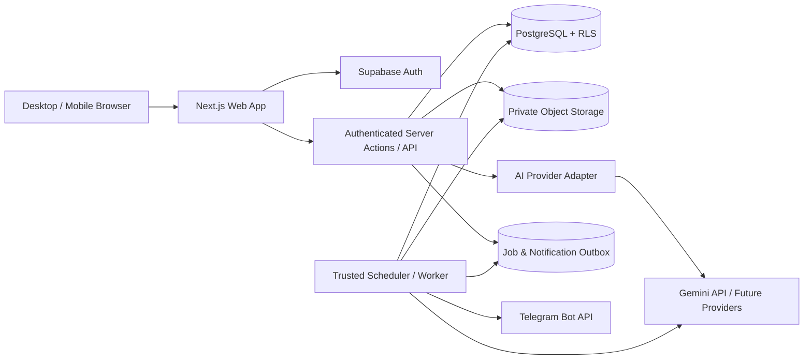
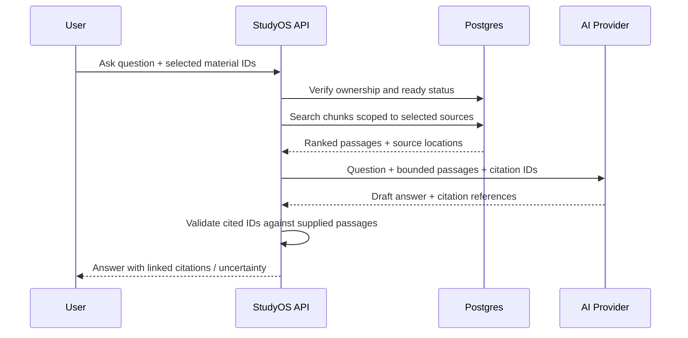
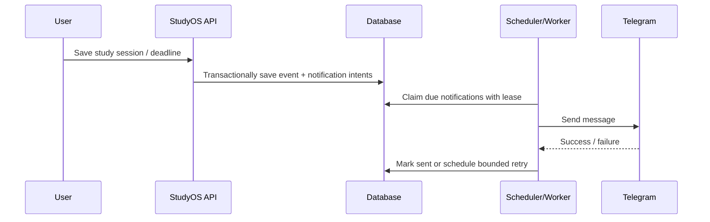

# StudyOS technical architecture

Primary specification is the [StudyOS master plan](../STUDYOS_MASTER_PLAN.md). This Phase 0 document records proposed implementation details pending owner approval.

## Phase 0 review

Next.js App Router with Supabase Auth, Postgres and private Storage is a viable foundation for one invited owner. Start with Vercel for the web tier, subject to project plan and budget confirmation. Keep feature logic shared by Server Actions and Route Handlers. Use request-scoped Supabase clients with verified auth and RLS for normal requests. Keep protected responses and session refresh responses out of shared caches. [Next.js authentication](https://nextjs.org/docs/app/guides/authentication) · [Supabase server-side auth](https://supabase.com/docs/guides/auth/server-side/nextjs)

### File transfer and processing

Vercel Functions cap request and response bodies at 4.5 MB. To support the proposed 25 MB ceiling, reserve quota and a private immutable object key server-side, then upload directly to Supabase Storage. Use resumable upload for larger files. Bucket rules constrain size/type, but a trusted finalizer or worker must inspect actual bytes and object metadata after upload. Keep pending or rejected objects inaccessible to readers. Finalize the verified material and enqueue extraction idempotently. Reclaim expired reservations and orphaned objects. Serve signed URLs after authorization and refresh them on expiry for long reader sessions. Extraction state is separate from original availability. [Vercel function limits](https://vercel.com/docs/functions/limitations) · [Supabase upload limits](https://supabase.com/docs/guides/storage/uploads/file-limits) · [Supabase resumable uploads](https://supabase.com/docs/guides/storage/uploads/resumable-uploads)

Evaluate React-PDF in Phase 2 with a client-only reader and matching bundled PDF.js worker. Verify licenses of pinned packages, iOS/Android rendering, range requests, expiry recovery and memory usage. Run the parser in a bounded job runtime chosen after a representative-file spike. Evaluate FullCalendar against simpler views in Phase 4 using mobile accessibility, bundle size and feature licensing. [React-PDF upstream](https://github.com/wojtekmaj/react-pdf) · [FullCalendar license](https://fullcalendar.io/license)

### Scheduling and dispatch

Vercel Hobby cron runs at most daily and has hourly precision. Supabase Cron supports a one-minute tick and HTTP dispatch. Prefer it as the initial reminder wake-up candidate, with a bounded authenticated worker and Postgres as the source of truth. Select a separate managed worker if staging shows the candidate cannot meet measured latency or runtime needs. Parsing and reminder dispatch can use different runtimes. Compare plan cost, uptime, function limits and request volume before committing. Measure due-to-send lag with the browser closed and exercise duplicate ticks, clock drift, worker failure and backlog recovery. A tick interval alone gives no delivery guarantee. [Vercel cron limits](https://vercel.com/docs/schedules/cron-jobs/usage-and-pricing) · [Supabase Cron](https://supabase.com/docs/guides/cron)

Materialize stable occurrences over the rolling horizon and replenish it on a durable tick. Keep the local start, IANA zone and recurrence definition on the series. Decide DST gap/overlap behavior and edit scope before Phase 4. Reschedule unsent intents on edits. Recheck revision, connection, quiet hours and expiry before sending. Use claim tokens to fence stale database updates and keep leases longer than bounded outbound calls. An in-flight Telegram request can still race a cancellation or become ambiguous after a timeout. Persist timer state server-side and make completion idempotent. Define how unattended time is reconciled before Phase 4.

### Optional AI

Keep the provider adapter and default AI to disabled. Gemini is a candidate only if its terms permit the intended personal deployment. The published terms restrict consumer use and describe different handling for unpaid and paid services. Use synthetic inputs for evaluation until eligibility and privacy approval are established. If eligibility is unresolved, keep Gemini disabled and evaluate an eligible provider in Phase 3. For approved providers, send only selected excerpts with consent, reserve usage against hard application caps before dispatch and validate all returned citations. [Gemini terms](https://ai.google.dev/gemini-api/terms) · [Gemini pricing](https://ai.google.dev/gemini-api/docs/pricing)

The master plan excerpts below provide feature detail. The reviewed transfer sequence above clarifies when signature checks can occur. See [DATABASE.md](DATABASE.md) for schema invariants and [SECURITY.md](SECURITY.md) for trust boundaries.

## Master plan detail

### 5. Recommended technology stack

| Layer | Proposed choice | Rationale / caution |
|---|---|---|
| Web | Next.js App Router, React, strict TypeScript | One codebase for server-rendered and interactive pages. |
| UI | Tailwind CSS, shadcn/ui, accessible primitives | Consistent responsive UI; own the generated components. |
| Forms/validation | React Hook Form + Zod | Shared runtime validation and typed forms. |
| Auth | Supabase Auth | Managed sessions; verify server/client auth boundaries. |
| Database | Supabase Postgres | SQL, transactions, RLS, migrations. |
| Files | Supabase private Storage buckets | Signed short-lived access and ownership policies. |
| Editor | Tiptap | Rich text; sanitize output and version edits. |
| PDF | PDF.js / react-pdf | Inline viewing, page navigation; check licensing/compatibility. |
| Calendar | FullCalendar or lighter custom views | Evaluate bundle size and mobile behavior before committing. |
| AI | Gemini API behind provider adapter | First provider to evaluate, not a hard dependency. |
| Retrieval v1 | Postgres full-text search + scoped chunks | Lower cost/complexity than vectors for initial scale. |
| Retrieval v2 | pgvector embeddings if needed | Add only after measured relevance limitations. |
| Background jobs | Durable DB job/outbox tables + scheduled worker | Hosting scheduler must wake a server-side worker; verify plan limits. |
| Hosting | Vercel + Supabase, or equivalent | Confirm cron frequency, execution timeout and costs before selection. |
| Testing | Vitest, React Testing Library, Playwright | Logic, component and cross-device flows. |
| Observability | Structured logs + error tracking | Redact tokens, user documents and prompts. |

**Critical deployment caveat:** Vercel cron frequency and limits vary by plan. For reminders requiring minute-level accuracy, verify current capabilities or use a suitable always-on worker / managed scheduler. Never rely on browser timers or a serverless function that is not invoked.

### 6. High-level system architecture



#### 6.1 Trust boundaries

- Browser is untrusted. All writes and reads require server-side authorization or scoped RLS policies.
- Storage is private. The client receives only time-limited signed URLs for authorized files.
- AI keys, Telegram bot tokens, service-role keys and scheduler secrets never enter client bundles.
- Worker has privileged access but explicitly checks user/resource ownership before processing jobs.
- Treat uploaded documents as untrusted content, including instructions embedded inside them.

#### 6.2 Suggested repository layout

```text
studyos/
├── AGENTS.md
├── README.md
├── .env.example
├── docs/
│   ├── PRD.md
│   ├── ARCHITECTURE.md
│   ├── DATABASE.md
│   ├── ROADMAP.md
│   ├── SECURITY.md
│   ├── DECISIONS.md
│   └── PROGRESS.md
├── supabase/
│   ├── migrations/
│   └── seed.sql
├── src/
│   ├── app/
│   │   ├── (auth)/login/
│   │   ├── (app)/dashboard/
│   │   ├── (app)/sessions/
│   │   ├── (app)/courses/[courseId]/
│   │   ├── (app)/library/
│   │   ├── (app)/planner/
│   │   ├── (app)/ai-studio/
│   │   ├── (app)/analytics/
│   │   ├── (app)/settings/
│   │   └── api/internal/jobs/
│   ├── components/{layout,ui,courses,library,notes,planner,ai}/
│   ├── features/{academics,materials,notes,ai,planner,telegram,analytics}/
│   ├── lib/{auth,db,storage,validation,logging}/
│   ├── server/{services,repositories,jobs}/
│   └── types/
├── tests/{unit,integration,e2e}/
└── package.json
```

Organize feature modules around business capabilities; avoid duplicating business logic between API routes and components.

### 10. Files and document-processing pipeline

#### 10.1 Upload flow

1. Authenticated user chooses a course and file.
2. Server validates course ownership, extension, actual MIME/content signature, max size and quota.
3. Create `materials` row with pending status and random object key such as `user-id/course-id/material-id/original`.
4. Upload to private storage with authorized short-lived upload token or authenticated storage policy.
5. Verify successful object write, persist metadata, enqueue extraction job.
6. Show file immediately in library even if extraction is pending.
7. Worker fetches file, parses safely, stores chunks and source page references, marks `ready` or `failed`.

**Suggested initial limits (configurable):** PDF/DOCX/PPTX/TXT/MD/JPEG/PNG; 25 MB/file; 250 MB total user storage. Confirm actual provider limits and costs. Scan/validate file types, enforce parsing timeouts and memory limits, never execute uploaded content or embedded macros.

#### 10.2 Extraction

- PDF: extract text and page mapping; show `needs_ocr` for image-only pages.
- DOCX: extract paragraphs/tables and approximate section labels.
- PPTX: extract slide text with slide numbers.
- TXT/MD: UTF-8 normalized text.
- Images: store/view normally; OCR/vision deferred unless explicitly enabled.
- Chunk by section/page boundaries where possible, with overlap; retain `material_id`, page/slide range and chunk ordinal.
- Do not invent page numbers if extraction cannot preserve them.
- Document processing failures must not delete or hide originals.

#### 10.3 Storage and retrieval

Use private buckets, opaque object keys, authorized signed URLs with short expiry, and storage deletion workflows. Search metadata first, then Postgres full-text chunks. Retrieval must filter by user and selected course/source IDs **before** ranking or passing text to the AI provider.

### 11. AI architecture

#### 11.1 Provider abstraction

Define interfaces such as `generateText`, `generateStructured`, and `estimateUsage`, with a Gemini implementation first. Keep provider configuration server-side. Record model/version, latency, failures, and usage; set per-user daily request and token limits, max output length, and explicit timeout/retry behavior. AI should be disabled gracefully when no key is configured.

#### 11.2 Grounded Q&A (RAG v1)



- Treat retrieved content as evidence, **not instructions**; explicitly resist prompt injection inside documents.
- Return only references to actual selected documents and verified page/slide ranges.
- Distinguish “according to your sources” from general model knowledge; default to source-only for grounded chat, with optional clearly labeled general explanation.
- When no relevant text is found, say so; never fabricate a citation.
- Persist conversation only when the feature is enabled and the user is authenticated.

#### 11.3 Generation formats

| Type | Required structure |
|---|---|
| Study notes | Title, sections, definitions, explanations, examples, references |
| Summary | Short/medium/detailed length, key takeaways, references |
| Flashcards | Prompt, answer, optional explanation and source link |
| MCQ quiz | Question, 4 options, correct answer, explanation, source link |
| Theory questions | Question, model answer, key points, source link |
| Study guide | Objectives, topic outline, review plan, references |

Validate structured output with Zod before saving. Generated content is marked `AI-generated`, editable, and never overwrites original notes. Preserve the source IDs and generation parameters. Do not present generated questions as authentic university past questions.

#### 11.4 Cost and privacy controls

Require explicit opt-in to send selected document excerpts to the configured AI provider. Display a brief privacy disclosure and relevant provider terms; avoid sending unrelated private files. Apply quotas, caching where appropriate, token budgets and clear error messages. No client-side API keys. Store only necessary request metadata in logs, not full source text by default.

### 12. Scheduling, timer and Telegram architecture

#### 12.1 Time model

Store instants in UTC (`TIMESTAMPTZ`) and the user's IANA timezone separately. Store recurrence definitions with timezone to preserve intended local wall-clock time; expand occurrences within a rolling scheduling horizon (e.g. 30 days). Account for edits, cancellations, DST in other zones, and missed jobs.

#### 12.2 Telegram linking

1. User opens Telegram integration page and requests a one-time link code/token.
2. Server generates a short-lived, single-use random token bound to authenticated user.
3. User opens the bot's deep link and sends `/start <token>`.
4. Secure bot webhook validates Telegram secret header (or equivalent authenticated transport), token expiry and one-time use.
5. Server binds verified `chat_id` to the user, then sends a test message.
6. User can unlink or disable notifications at any time.

Do not trust a chat ID typed into a browser as proof of ownership. Keep bot token in server secret storage.

#### 12.3 Durable reminder workflow



- Use an outbox/notification table with deterministic `idempotency_key` (user + event occurrence + reminder type + offset + revision).
- Claim jobs atomically using row locking/leases (e.g. `FOR UPDATE SKIP LOCKED`), so concurrent workers do not send the same pending job.
- On event edit/cancel, invalidate unsent notification intents and create new ones.
- Retry transient failures with bounded exponential backoff; respect Telegram rate limits and `retry_after`.
- Record delivery outcome and expose a troubleshooting status in settings.
- **Delivery semantics:** exact-once external messaging cannot be guaranteed across network failures; aim for at-least-once processing with deduplication, acknowledging rare duplicate risk after ambiguous Telegram responses.
- Support quiet hours and configurable lead times; daily summary should be computed from the user's local day.
- Scheduler must run independently of the browser. Test real production scheduling frequency before promising exact timing.

#### 12.4 Study timer accuracy

Maintain timer state with start/pause/resume timestamps and accumulated active seconds. Use a monotonic clock for on-screen elapsed time; reconcile with persisted server timestamps on reload. Do not count paused time, double-submit completion, or blindly count time while an inactive browser is suspended. Allow user correction of actual duration with audit-friendly updates.

### 15. Reliability, operations and deployment

#### 15.1 Environments

- **Local:** `.env.local` with development Supabase project or local Supabase stack; never production keys.
- **Preview/staging:** separate database/storage and test bot where practical.
- **Production:** managed database, private storage, HTTPS, configured cron/worker and verified webhook.

#### 15.2 Deployment checklist

1. Confirm domain, environment variables and service limits.
2. Apply versioned database migrations to staging; test RLS policies.
3. Configure private storage bucket policies and file caps.
4. Deploy app and configure authentication callback URLs.
5. Configure AI provider credentials and spending caps.
6. Configure Telegram bot token, webhook secret and link flow.
7. Deploy and test scheduler/worker independently of open browsers.
8. Run end-to-end tests on desktop and mobile viewport.
9. Verify backup and restore procedure, alerts and error monitoring.
10. Conduct a production smoke test with real file, note, study event and Telegram reminder.

#### 15.3 Recovery

Document database backup frequency/retention based on the selected provider plan. Ensure file backups/exports are separately considered; database backups alone may not restore object storage. Support manual export of notes and metadata early. Use migrations and version control for reproducible rollback.
