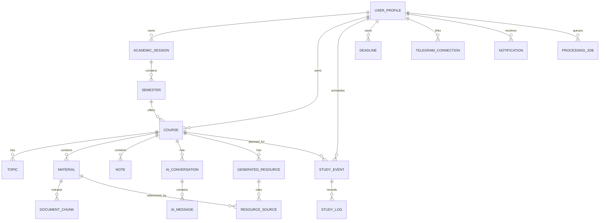

# StudyOS database design

Primary specification is the [StudyOS master plan](../STUDYOS_MASTER_PLAN.md). This Phase 0 document records proposed implementation details pending owner approval.

## Proposed integrity rules

- Use Supabase Auth user UUID as the profile ID. For owned children, enforce composite foreign keys including the owner and any required scope, such as course for topic/material links and selected sources. Add matching unique parent keys. Owner policies alone cannot prevent same-owner, cross-course references.
- Keep course identity stable when transferring. Normalize course codes for semester uniqueness. Explicitly decide standalone code uniqueness, archived-code reuse and same-semester collisions. Enforce same-course topic parents and reject hierarchy cycles in a transaction.
- Make seed import transactional and repeatable for an explicitly selected semester. Resolve conflicts without overwriting user edits. Use archive or restricted deletes for academic parents with study history.
- Model upload reservations and verified original availability independently of extraction state. Finalization verifies the object key and size, consumes the reservation and enqueues one job. Keep storage keys opaque and immutable. Publish replacement chunk sets atomically, and define how existing citations keep their source locations on reprocessing or deletion.
- Save notes with a revision compare-and-update and return an explicit conflict for stale clients. Keep conversation-source and resource-source joins course-scoped. Validate generated structured content and persist source and model provenance.
- Add a durable occurrence identity for recurrence exceptions, reminder deduplication, study logs and schedule adherence. Unplanned logs may have no event. If the product allows course-less planned events to be logged, allow a nullable course on those logs and define analytics attribution. Decide how midnight-spanning logs contribute to local-day metrics.
- Add server-only hashed Telegram link tokens with expiry and atomic redemption. Use a unique active connection per user, and deduplicate retried webhook updates where side effects occur. Give notifications and jobs due-time indexes, claim tokens and bounded retry state. Use typed foreign keys where practical and validate any polymorphic target transactionally.
- Restrict table grants as well as RLS. Put schema, privileges, indexes and policies in migrations. Run two-user tests for reads, writes, cross-owner foreign keys and same-owner scope mismatches.

## Master plan detail

### 9. Data model

#### 9.1 Conceptual ER diagram

#### 9.2 Core tables (initial proposal)

Every user-owned table has `user_id UUID NOT NULL` unless ownership is provably inherited and policies safely enforce it. Common fields: `id UUID PRIMARY KEY`, `created_at TIMESTAMPTZ`, `updated_at TIMESTAMPTZ`.

| Table | Key fields and constraints |
|---|---|
| `profiles` | `id` references auth user, `timezone`, `display_name`, preferences |
| `academic_sessions` | `user_id`, `label`, optional start/end dates, `archived_at`; unique user+label |
| `semesters` | `user_id`, `academic_session_id`, `name`, `sort_order`, optional dates; unique session+name |
| `courses` | `user_id`, nullable `semester_id` for standalone courses, `code`, `title`, `units`, `description`, `status`, `archived_at`; unique per semester+code where appropriate |
| `topics` | `user_id`, `course_id`, nullable `parent_topic_id`, `title`, `sort_order`, `completed_at` |
| `materials` | `user_id`, `course_id`, nullable `topic_id`, `name`, `mime_type`, `byte_size`, `storage_key`, `sha256`, `processing_status`, `page_count`, `deleted_at` |
| `document_chunks` | `user_id`, `material_id`, `chunk_index`, `text`, optional `page_start/page_end`, `text_search_vector`; unique material+index |
| `notes` | `user_id`, `course_id`, nullable `topic_id`, `title`, sanitized rich-text JSON, `revision`, `kind` (`personal`/`generated`), `deleted_at` |
| `ai_conversations` | `user_id`, `course_id`, `title`, optional selected source IDs as a separate join table |
| `ai_messages` | `user_id`, `conversation_id`, `role`, `content`, structured citation metadata, `model`, `created_at` |
| `generated_resources` | `user_id`, `course_id`, `kind`, `title`, structured content, `model`, `prompt_version`, `status` |
| `resource_sources` | `user_id`, `resource_id`, `material_id`, optional `chunk_id`/page range |
| `study_events` | `user_id`, nullable `course_id`/`topic_id`, `title`, `start_at`, `end_at`, `timezone`, `recurrence_rule`, `recurrence_until`, `status` |
| `study_logs` | `user_id`, `study_event_id` nullable, `course_id`, `started_at`, `ended_at`, `active_seconds`, `source`, `status` |
| `deadlines` | `user_id`, nullable `course_id`, `kind`, `title`, `due_at`, `status` |
| `telegram_connections` | `user_id`, `chat_id` (server-only), `verified_at`, `revoked_at`; do not store bot token per user |
| `notification_preferences` | `user_id`, enabled types, lead times, quiet hours, daily summary time |
| `notifications` | `user_id`, `kind`, `entity_type`, `entity_id`, `scheduled_for`, `status`, `attempts`, `next_attempt_at`, `idempotency_key` unique, `sent_at`, `last_error_code` |
| `processing_jobs` | `user_id`, `kind`, `resource_id`, `status`, `attempts`, `run_after`, `locked_until`, `error_code` |
| `ai_usage` | `user_id`, `provider`, `model`, token/cost estimates, operation, timestamp |

**Important normalization decisions:** Add `conversation_sources` for selected chat materials; store quiz/flashcard content as validated structured JSON initially, splitting into dedicated question/answer tables only when scheduling, querying, or analytics require it. Use explicit foreign keys and composite ownership checks to prevent attaching one user's material to another user's course.

#### 9.3 Integrity and indexes

- Index `user_id` plus common filter/sort columns (`course_id`, `created_at`, `start_at`, `due_at`).
- Add GIN full-text indexes for searchable extracted chunks; use a consistent text-search configuration.
- Unique constraints on notification idempotency keys, document chunk order, and semester-specific course codes where appropriate.
- Check constraints: `units >= 0`, `end_at > start_at`, `active_seconds >= 0`, valid enum/status values.
- Soft-delete materials/notes first; asynchronously remove storage objects only after references are handled.
- Prevent cross-user foreign-key relationships using composite keys or server-side checks plus tested RLS.
- Use database migrations; never manually edit production schema without a migration.

#### 9.4 RLS policy pattern

Enable RLS for every user-owned table. Baseline policy: authenticated `auth.uid() = user_id` for permitted SELECT/INSERT/UPDATE/DELETE, plus checks that referenced parent rows belong to the same user. Restrict sensitive tables (Telegram connections, job queues, provider usage) to appropriate server paths where possible. The service-role key is server-only and bypasses RLS; its use must be narrowly audited.
